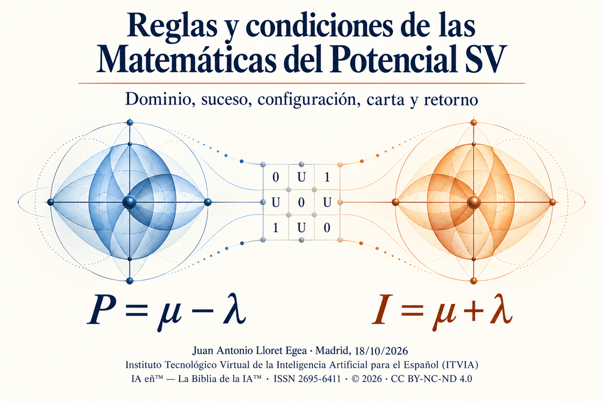

# Reglas y condiciones de las Matemáticas del Potencial SV

**Matemáticas del Potencial SV · Primera publicación**

**Autoría:** Juan Antonio Lloret Egea. **Fecha de revisión:** 18 de octubre de 2026.

## Resumen

Este trabajo establece las condiciones de definición, cálculo e interpretación del potencial en el Sistema Vectorial SV. Parte de la célula ternaria, del horizonte y del suceso admisible para precisar cuándo una lectura polar permite obtener un potencial, comparar sus valores o estudiar su variación. La exposición distingue el objeto evaluado, su configuración, los observables que lo describen y las representaciones auxiliares empleadas para el cálculo. Sobre esa base se delimitan el dominio, la variable de carta, las unidades, el residual y el retorno.

La diferencia entre polos se considera junto con su intensidad: un potencial nulo puede corresponder a un equilibrio con intensidad positiva y, por tanto, no determina por sí solo la frontera de nulidad conjunta. La admisión de una fórmula exige, además de corrección algebraica, una justificación de sus hipótesis y de la correspondencia entre los objetos comparados. Se establecen restricciones para las derivadas, las distancias y las acumulaciones, y se explica la compatibilidad requerida con la Teoría del TODO y de la NADA. A partir del antecedente de orientación universal y geográfica, se precisan el dominio de la proyección Atlas y la cota que conserva sus polos no negativos. El tratamiento de U conserva la indeterminación como resultado justificado, distingue ese resultado del trabajo pendiente y vincula su resolución a nueva información pertinente o a intervención experta. Las tablas finales reúnen símbolos, condiciones de uso y motivos de exclusión. El documento ofrece así una base de lectura suficiente para los seis desarrollos posteriores de la colección.

**Palabras clave:** potencial; Sistema Vectorial SV; suceso admisible; separación polar; configuración; dominio; variable de carta; residual; indeterminación; retorno.

## Índice

1. Objeto matemático de la colección.
2. Adscripción al sistema matemático y a los fundamentos del Sistema Vectorial SV.
3. Relación de catálogo con el Tesauro de matemáticas del Sistema Vectorial SV.
4. Relación funcional con Transductores de matemáticas.
5. Criterio de compatibilidad de máximo rango: Teoría del TODO y de la NADA.
6. Condición negativa: el tiempo no opera como primitiva.
7. Condición negativa: la probabilidad no opera como fundamento.
8. Condición negativa: la estadística no opera como criterio de verdad.
9. Condición negativa: la inferencia opaca no opera como cierre.
10. Condición positiva: dominio declarado.
11. Condición positiva: suceso admisible.
12. Condición positiva: *frame* legible.
13. Condición positiva: variable de carta declarada.
14. Condición positiva: residual controlado.
15. Condición positiva: retorno al dominio correspondiente.
16. Tabla de símbolos y variables del potencial.
17. Tabla de condiciones de uso.
18. Tabla de restricciones de uso y condiciones de exclusión.
19. Criterio de admisión de nuevas fórmulas del potencial.
20. Cierre de reglas y condiciones.

## 1. Objeto matemático de la colección

Las Matemáticas del Potencial SV estudian la separación polar de los sucesos admisibles, su lectura sobre configuraciones y las operaciones que permiten comparar, medir y acumular sus variaciones. Su objeto comprende tanto las magnitudes obtenidas como las condiciones que hacen legítimo su uso. Por ello, una fórmula de potencial debe identificar el dominio al que se refiere y la regla mediante la cual asigna valores a sus argumentos [1, 5].

El antecedente inmediato de esta colección es el estudio sobre orientación universal y geográfica [11]. Allí se relacionan potencial del suceso, intensidad, interfaz de dominio e individuación, y se desarrolla la proyección sobre la Recta Atlas. Este documento recoge ese origen y explicita las condiciones matemáticas que necesita: dominio de la proyección, escala, límites del diferencial y separación entre representación formal y explicación de un fenómeno. La Teoría del TODO y de la NADA [6] interviene como referencia de compatibilidad general; cumple una función distinta de la del antecedente de orientación.

Sea D un dominio declarado y e un suceso cuya admisibilidad se haya establecido en ese dominio. Una lectura polar asigna a e dos componentes no negativas, μ_D(e) y λ_D(e), expresadas en una misma escala. El orden de estas componentes se conserva. Cuando la lectura y sus condiciones de aplicación están verificadas, se definen:

> P_D(e) = μ_D(e) − λ_D(e).
>
> I_D(e) = μ_D(e) + λ_D(e).

P_D(e) es el potencial e I_D(e), la intensidad polar. En la formulación general, los componentes pertenecen a los reales no negativos; determinados dominios pueden restringirlos a conteos enteros u otras clases expresamente definidas. La elección del dominio numérico precede a las operaciones. El símbolo U no forma parte de estos números ni interviene en la resta [5, §II y §IV].

**Proposición 1. Nulidad del potencial y nulidad conjunta.** Para μ y λ no negativas, P = 0 equivale a μ = λ; I = 0 equivale a μ = λ = 0. En consecuencia, P = 0 no implica I = 0.

**Demostración.** La primera equivalencia procede de μ − λ = 0. En la segunda, una suma de dos números no negativos sólo puede ser cero si ambos son cero. El par (a,a), con a > 0, satisface P = 0 e I = 2a > 0 y prueba la última afirmación.

Por ejemplo, (4,4) da P = 0 e I = 8, mientras que (0,0) da P = 0 e I = 0. El primer par expresa equilibrio polar en el régimen declarado; el segundo satisface la condición algebraica de nulidad conjunta. Su interpretación como frontera formal requiere, además, las condiciones del dominio. Del mismo modo, (7,2) y (9,4) tienen potencial 5 e intensidades distintas, 9 y 13. La igualdad de potencial no identifica los pares polares ni los sucesos de los que proceden.

La colección distribuye el estudio en siete publicaciones: condiciones generales; potencial del suceso; configuración y carta; diferencial; métrica y acumulación; residual y retorno; transducción y pruebas reproducibles. Esta primera entrega fija los requisitos comunes. Los ejemplos que contiene explican esos requisitos y no sustituyen las demostraciones específicas que correspondan a los desarrollos posteriores.

## 2. Adscripción al sistema matemático y a los fundamentos del Sistema Vectorial SV

El punto de partida es el alfabeto Σ = {0,1,U}. En la convención general del SV, 0 expresa aptitud o cumplimiento, 1 expresa no aptitud o incumplimiento y U expresa indeterminación. Cada dominio debe explicar la lectura concreta de esos valores sin alterar su distinción [2, 3].

Una célula de base b, con b entero y b ≥ 3, dispone de n = b² posiciones. Su espacio de configuraciones es K₃ⁿ = {0,1,U}ⁿ. La notación SV(n,b) indicará aquí, en ese orden, el número de posiciones y la base de organización. Así, SV(9,3), SV(16,4) y SV(25,5) comparten el mismo alfabeto de tres símbolos. El cambio de b modifica el tamaño de la célula, no el número de valores ternarios. Existen 3ⁿ configuraciones posibles porque cada una de las n posiciones admite tres asignaciones [2, §3].

Una configuración S = (s₁,…,sₙ) es un elemento de ese conjunto. Las publicaciones del SV también la denominan *frame*. Conservar ambos términos permite reconocer el objeto en los antecedentes; la exposición utilizará preferentemente «configuración» cuando no se necesite destacar la denominación específica. U es un valor semántico del alfabeto, no el número 3 ni un punto intermedio entre 0 y 1. Cualquier representación mediante radios, colores o coordenadas constituye una codificación adicional y debe declararse como tal.

De esta base se sigue una precaución algebraica. El producto cartesiano K₃ⁿ no es, por su sola definición, un espacio vectorial sobre un cuerpo. Para atribuirle operaciones adicionales habría que definirlas y demostrar sus propiedades. Tampoco la representación de una célula mediante un polígono convierte automáticamente sus posiciones en puntos de un dominio físico continuo.

El estudio conserva esta separación entre estructura ternaria, representación y magnitudes derivadas. El potencial se obtiene mediante una lectura admisible de un objeto del SV; no procede de convertir directamente los símbolos de la célula en números reales. Cuando un dominio define μ y λ mediante conteos, es el número de posiciones que satisfacen una condición el que interviene en la aritmética. El significado de cada posición se mantiene.

## 3. Relación de catálogo con el Tesauro de matemáticas del Sistema Vectorial SV

El Tesauro reúne las nociones, operaciones y relaciones matemáticas del sistema y establece una lectura progresiva, desde las configuraciones celulares hasta los desarrollos especializados. Para cada objeto exige función, dominio, variables, condiciones de uso y límites de aplicación. Las Matemáticas del Potencial SV se adscriben a esa organización como una especialización temática [8].

La relación de catálogo exige que un símbolo conserve la definición que se cita o que cualquier especialización quede expresamente delimitada. Un cambio de letra no constituye una nueva operación; a la inversa, compartir una letra no demuestra identidad entre objetos. Este segundo caso resulta especialmente importante para μ y λ: en el potencial local designan componentes polares, mientras que la Teoría del TODO y de la NADA las emplea también para magnitudes de cierre de trayectorias. La relación entre ambos usos debe establecerse mediante sus dominios y reglas de correspondencia [5, §II.2; 6, §2.12].

Cada nueva fórmula de la colección deberá acompañarse de una referencia a su antecedente o de una definición suficiente para reconocer la aportación. Las propiedades demostradas se distinguirán de las convenciones adoptadas. Los ejemplos permitirán comprender una regla, pero su buen resultado en varios casos no se presentará como demostración universal.

Esta organización facilita una lectura autónoma: el lector encontrará aquí las nociones necesarias para entender las condiciones del potencial y podrá acudir a las referencias para estudiar su desarrollo completo. La autonomía expositiva no implica independencia respecto de los fundamentos.

## 4. Relación funcional con Transductores de matemáticas

Una transducción establece un paso entre dominios mediante una correspondencia declarada. En el caso del potencial, debe precisar qué objeto se transporta, cuáles son el origen y el destino, qué magnitudes se conservan y cómo se interpreta el resultado. La colección de Transductores distingue esta función de la correlación, la proyección, el cambio de representación y el retorno [7].

Considérense dos dominios D y E. La escritura T: D → E sólo informa de una dirección; no demuestra por sí misma que T conserve los potenciales. Será necesario definir una correspondencia entre los objetos y otra, si procede, entre sus escalas. Si f transporta los sucesos y g transforma los valores, una condición posible de conservación es:

> P_E(f(e)) = g(P_D(e)).

Esta igualdad se exigirá únicamente en el subconjunto para el que haya sido declarada y demostrada. Si g(p) = ap + c, con a > 0, las diferencias se transforman según ΔP_E = a·ΔP_D. El desplazamiento c desaparece al restar, pero modifica el valor asignado al origen. Por tanto, conservar diferencias no basta para conservar la referencia de potencial nulo. Si se exige también g(0) = 0, necesariamente c = 0.

El ejemplo muestra por qué deben indicarse las propiedades que se pretenden conservar. Una transducción puede respetar el orden y modificar las unidades; otra puede conservar una relación de equivalencia sin ser invertible. Ninguna de esas posibilidades debe suponerse por semejanza verbal entre magnitudes.

Cuando dos sucesos pertenecen a dominios distintos, su comparación requiere una lectura común o una transducción suficiente. Hasta que se establezca esa correspondencia, restar sus valores sólo produce una expresión numérica sin interpretación acreditada. En particular, la unidad estructural del potencial no se convierte en voltios, julios o cualquier otra unidad física mediante un cambio de nombre [5, §IX.4 y §XII].

## 5. Criterio de compatibilidad de máximo rango: Teoría del TODO y de la NADA

La colección sitúa su criterio superior de compatibilidad en la Teoría del TODO y de la NADA. En ese ámbito, la ecuación rectora se expresa como [1, 6]:

> 𝓔★_TODO,SV(Γ_U; τ) = 0.

Γ_U designa la trayectoria universal declarada y τ, el conjunto de definiciones, leyes y horizontes reconocido para la evaluación. Ninguno de estos símbolos introduce aquí una variable temporal. El Universo de Sucesos delimita los sucesos formulables en ese régimen; las configuraciones pertenecen a K₃ⁿ, y la condición (μ,λ) = (0,0) exige la nulidad simultánea de las magnitudes de cierre correspondientes.

La ecuación reúne defectos relativos al origen formal, al Universo de Sucesos, a su fundamento declarado, a las condiciones de cada ciclo y a la compatibilidad de las leyes de dominio. La nulidad de una diferencia polar local no demuestra, por sí sola, la nulidad de ese conjunto. Tampoco un ejemplo sobre SV(9,3) acredita el agotamiento de todas sus configuraciones: tal afirmación exige comprobar la igualdad entre la imagen considerada y el espacio configuracional completo.

El verificador ternario fuerte, 𝓝★_SV, recibe una familia finita y no vacía de resultados de comprobación r₁,…,rₘ. Su regla es la siguiente [6, §13]:

| Condición sobre las comprobaciones | Resultado |
|---|---|
| Todas tienen valor 0. | 0: se satisfacen las condiciones examinadas. |
| Al menos una tiene valor 1. | 1: se ha establecido un incumplimiento. |
| Ninguna tiene valor 1 y al menos una tiene valor U. | U: la evaluación no permite una conclusión binaria. |

**Proposición 2. Unicidad del resultado del verificador.** Las tres condiciones de la tabla son mutuamente excluyentes y cubren todas las familias de entrada cuyos elementos pertenecen a {0,1,U}.

**Demostración.** Si aparece un 1, sólo se cumple la segunda condición. En su ausencia, o bien aparece U y se cumple la tercera, o bien todos los elementos son 0 y se cumple la primera. No queda otra posibilidad.

Para las fórmulas del potencial, la compatibilidad requiere identificar las hipótesis y operaciones heredadas, declarar las especializaciones y justificar las correspondencias con el dominio. Cuando se invoque una ley de la teoría general, deberá indicarse la proyección que permite aplicarla. Esta exigencia expresa una relación formal comprobable; una declaración de adhesión al sistema no basta para satisfacerla.

La verificación del potencial local y la de la ecuación rectora tienen alcances diferentes. Un resultado local favorable acredita las condiciones efectivamente examinadas. Sólo una evaluación completa de las componentes correspondientes permitiría afirmar el resultado general.

## 6. Condición negativa: el tiempo no opera como primitiva

El cambio en el SV se describe mediante sucesos y reevaluaciones en horizontes declarados. Una secuencia S₀, S₁,…,Sₘ expresa un orden de configuraciones. El subíndice k identifica una posición de la secuencia y no presupone duración entre sus términos [4, 9].

Esta distinción permite estudiar una variación Pₖ₊₁ − Pₖ sin atribuirle el significado de velocidad. Para dividirla por otro valor debe existir una escala de comparación declarada. Una diferencia entre índices, un intervalo de carta y una duración medida son objetos distintos, aunque en una representación particular se escriban mediante números reales.

Una magnitud temporal procedente de un dominio físico puede incorporarse como dato, registro o coordenada auxiliar. En ese caso se explicarán su unidad y su función. Su presencia en una aplicación no cambia el fundamento del cálculo general. De igual manera, una fecha de observación permite localizar un registro, pero no demuestra que el suceso esté constituido por esa fecha.

Toda derivada deberá identificar su variable. La notación dP/dα, cuando resulte admisible, se referirá a una carta de potencial previamente definida. No recibirá una interpretación temporal por el mero hecho de tener la forma de un cociente diferencial. Las condiciones para introducir ese límite se precisan en el apartado 13.

## 7. Condición negativa: la probabilidad no opera como fundamento

La valoración ternaria expresa cumplimiento, incumplimiento o indeterminación bajo reglas del dominio. No asigna probabilidades a esos tres resultados. En particular, U no equivale a una probabilidad de un medio ni a una distribución entre 0 y 1 [2, 3].

Si un estudio externo aporta una probabilidad, el documento deberá identificar el modelo que la produce y el alcance de su uso. Tal dato puede formar parte de un contraste o de la descripción de una fuente; no sustituye la comprobación requerida por una condición del SV. Una afirmación considerada muy probable no adquiere, por esa razón, el mismo estatuto que una propiedad demostrada.

En el cálculo del potencial tampoco cabe reemplazar una componente polar indeterminada por su valor esperado para presentar el resultado como determinado. Esa sustitución introduce una operación y unas hipótesis adicionales. Sólo podría estudiarse como una representación auxiliar expresamente delimitada, manteniendo visible la diferencia respecto del potencial cuya admisibilidad se investiga.

La condición afecta al fundamento de la conclusión, no a la posibilidad de describir con exactitud métodos probabilísticos empleados fuera del sistema. El contraste entre marcos requiere conservar el significado propio de cada uno.

## 8. Condición negativa: la estadística no opera como criterio de verdad

Una frecuencia observada, una media o un ajuste estadístico describen un conjunto de datos bajo determinadas decisiones de muestreo y análisis. Por sí mismos no demuestran una identidad matemática ni la validez universal de una regla del potencial.

La distinción se aprecia en un caso elemental. Si varias trayectorias presentan igualdad entre recorrido absoluto y diferencia de extremos, esos ejemplos no autorizan a afirmar que ambas magnitudes coincidan siempre. Para una sucesión de valores 0, 2, 0, la diferencia de extremos es cero y el recorrido absoluto es cuatro. Una sola sucesión admisible de esa clase refuta la igualdad universal, con independencia del número de ejemplos favorables reunidos.

Las comprobaciones exhaustivas sobre un conjunto finito pueden constituir una demostración por casos si el conjunto coincide exactamente con el dominio del enunciado y cada caso se verifica de manera válida. Una muestra, por amplia que sea, no satisface ese requisito cuando quedan casos sin examinar.

La colección distinguirá, por ello, demostración, comprobación exhaustiva, ejemplo ilustrativo y contraste empírico. Los laboratorios previstos en su séptima publicación consisten en pruebas formales reproducibles dentro del SV [1]. Cuando una aplicación formule además una afirmación sobre un fenómeno físico, biológico o de otro ámbito empírico, deberá aportar las observaciones y condiciones de contraste que correspondan a esa afirmación; la consistencia formal no las reemplaza.

Esta distinción afecta a la expresión «causa directriz» utilizada en el antecedente de orientación [11, §§4 y 11]. La identidad P = μ − λ define una magnitud; no demuestra por sí sola que esa magnitud cause una trayectoria. El signo de P tampoco proporciona una dirección espacial sin una correspondencia entre los polos y el dominio. Una explicación causal necesita una regla que relacione las magnitudes con los cambios observables y un contraste capaz de discriminarla frente a otras explicaciones. Los ejemplos sintéticos de individuación de [11, §8.10] ilustran la representación propuesta, pero no constituyen mediciones ni pruebas de causalidad biológica.

Un resultado empírico discrepante debe examinarse atendiendo a su método, incertidumbre y correspondencia con el dominio. La incompatibilidad con una formulación previa no basta para descartarlo. El examen puede revelar una diferencia de alcance, una limitación de la medición o la necesidad de revisar la aplicación del modelo. Mantener esta posibilidad de revisión es una condición de su contrastación científica.

## 9. Condición negativa: la inferencia opaca no opera como cierre

Una conclusión matemática debe permitir reconstruir el paso desde los datos y las hipótesis hasta el resultado. Para ello han de identificarse las definiciones utilizadas, las operaciones realizadas y las condiciones bajo las que esas operaciones están permitidas.

La exigencia no obliga a repetir cada demostración previa en todos los apartados. Una referencia precisa puede justificar un resultado heredado, siempre que sus hipótesis coincidan con las del uso actual. La omisión se vuelve problemática cuando oculta una diferencia de dominio, una condición no comprobada o una modificación del objeto.

Los procedimientos automáticos pueden apoyar cálculos y verificaciones. El documento deberá explicar qué comprobación realizan y qué permite concluir su resultado. La ejecución satisfactoria de varios ejemplos acredita esos ejemplos; una demostración general necesita un argumento que abarque todos los casos de su enunciado. Una salida sin justificación examinable no resuelve una condición matemática pendiente.

En particular, una evaluación no completada se registrará como pendiente. No se le asignará automáticamente U, ni se presentará un fallo instrumental como refutación del objeto. Estas situaciones describen el estado del procedimiento; los valores del verificador describen el resultado de las comprobaciones admitidas. El apartado 14 desarrolla esa separación.

## 10. Condición positiva: dominio declarado

El dominio D determina qué objetos se estudian, qué datos permiten reconocerlos y qué operaciones tienen sentido sobre ellos. Su declaración debe ser suficiente para decidir si un ejemplo pertenece al ámbito del enunciado. Un nombre como «físico», «biológico» o «documental» no proporciona por sí solo esa información.

Para el potencial deberán precisarse la familia de sucesos, los horizontes pertinentes, los observables de lectura, la orientación de los polos y la escala de sus valores. También se indicarán la frontera de aplicación y las relaciones que permiten comparar registros. Las condiciones de transducción se añadirán cuando intervengan varios dominios.

La frontera delimita qué pertenece al objeto evaluado y qué se considera exterior para la operación. No tiene que ser una superficie geométrica: puede ser una condición de pertenencia, una restricción de observación o un límite de aplicación. Su definición determina qué información debe conservarse para interpretar el resultado.

Conviene distinguir D del dominio D_e de un operador de reevaluación. D describe el ámbito del estudio; D_e contiene las configuraciones de entrada sobre las que actúa un suceso concreto. La pertenencia de un suceso a D no demuestra que pueda aplicarse a cualquier configuración de ese ámbito.

**Ejemplo.** Si μ_D(e) y λ_D(e) cuentan posiciones resueltas de dos clases en una célula de nueve posiciones, la suma de ambos conteos no puede exceder nueve cuando las clases son disjuntas. El par (7,5) incumple esa condición de este dominio, aunque ambos números sean no negativos. El mismo par podría pertenecer a otro régimen de magnitudes polares. La corrección de una resta se decide aritméticamente; la pertenencia de sus argumentos se decide mediante la definición de D.

La escala tampoco puede cambiarse de forma implícita. Si un registro utiliza unidades elementales y otro agrupa cada diez unidades, la comparación exige expresar ambos en una escala común. Cualquier cambio deberá conservar su justificación y la referencia al registro de origen.

## 11. Condición positiva: suceso admisible

El potencial se atribuye a un suceso cuya admisibilidad pueda examinarse. Para precisar esa exigencia se adopta la estructura de la teoría del suceso del SV [4]. Un horizonte se representa por H = (I_H, ≼_H, X_H, A_H): I_H reúne las posiciones o regiones de lectura; ≼_H expresa la relación interna pertinente; X_H contiene las configuraciones legibles, y A_H reúne los observables admitidos. La interpretación concreta de cada componente debe acompañar al modelo.

Un candidato a suceso es una cuádrupla e = (H, H′, σ, R_e). Sus componentes identifican el horizonte inicial, el horizonte resultante, el soporte de afectación y el operador de reevaluación. Este último tiene la forma R_e: D_e → X_H′, con D_e contenido en X_H y no vacío. Se requieren las siguientes condiciones:

| Condición | Contenido matemático |
| --- | --- |
| A1. Soporte | σ es un subconjunto de I_H. |
| A2. Aplicabilidad | D_e no es vacío y R_e lleva sus elementos a X_H′. |
| A3. Legibilidad | Cada entrada y su resultado pueden leerse en los horizontes correspondientes. |
| A4. Cambio efectivo | Existe una entrada y un observable compatible cuya variación está definida y es distinta de cero. |
| A5. Control exterior | Se identifica una región exterior J_e, contenida en I_H fuera de σ, y una correspondencia parcial θ_e hacia I_H′ que permite conservar su referencia. |
| A6. Compatibilidad | Las reglas de comparación de los observables entre H y H′ están especificadas. |

Para un observable numérico compatible F y una entrada x de D_e, la variación es:

> Δ_e F(x) = F_H′(R_e(x)) − F_H(x).

La condición A5 no afirma, por sí sola, que todo el exterior permanezca invariable. Si una aplicación necesita esa invariancia, deberá formularla y comprobarla. Del mismo modo, A4 exige un cambio en algún observable compatible; no impone que cambien todos los observables ni que el potencial elegido distinga cualquier suceso.

**Ejemplo de admisibilidad formal.** En un horizonte con nueve posiciones, tómense S₀ = (0,0,0,0,0,0,0,0,0) y S₁ = (0,0,0,0,1,0,0,0,0). Sea X_H = {0,1,U}⁹ y H′ = H, con una relación de índices fija. Defínanse D_e = {S₀}, R_e(S₀) = S₁, σ = {5} y J_e = {1,2,3,4,6,7,8,9}; θ_e es la identidad sobre J_e. El observable F cuenta las posiciones inscritas con 1 y se utiliza con la misma regla en ambos extremos. Las entradas y salidas pertenecen a X_H, el exterior conserva su referencia y Δ_e F(S₀) = 1. Se cumplen A1–A6.

El ejemplo verifica un operador entre configuraciones; no afirma que sea lícito alterar un registro ya consolidado en cualquier aplicación. Un régimen que conserva las determinaciones anteriores y añade posiciones deberá representar la nueva evaluación sin sobrescribirlas [9]. Las condiciones particulares del dominio se suman a A1–A6.

La composición también requiere examen. Si dos operadores sucesivos devuelven cada configuración a su estado inicial, su composición puede carecer del cambio exigido por A4. Por tanto, que los factores sean sucesos admisibles no basta para atribuir ese mismo carácter a su composición.

## 12. Condición positiva: *frame* legible

Un *frame* es la configuración que hace legible un suceso bajo un horizonte y unas reglas de observación. Su contenido no se reduce a una disposición gráfica. Deben poder reconocerse las posiciones, el significado de las inscripciones, el alcance de la lectura y la relación con el objeto representado.

Cuando el potencial se evalúa a partir de una configuración S, se necesita una regla que vincule esa configuración con el suceso. Sólo entonces podrá emplearse una escritura como P_D(S), entendida como abreviatura de la evaluación inducida por dicha regla. La coincidencia de dos configuraciones visibles no demuestra que correspondan al mismo suceso; tampoco la igualdad de sus valores de potencial establece esa identidad.

Una secuencia S₀,…,Sₘ exige una realización conjunta: debe existir una entrada inicial y una sucesión de aplicaciones tales que cada resultado sea una entrada admitida por el operador siguiente. Comprobar por separado que cada pareja de operadores tiene alguna entrada compatible no garantiza que una misma cadena de entradas atraviese la secuencia completa.

En una trayectoria realizada y con valores reales comparables p₀,…,pₘ, se distinguen dos cantidades:

> Diferencia neta: N = pₘ − p₀ = (p₁ − p₀) + ··· + (pₘ − pₘ₋₁).
>
> Recorrido absoluto: L = |p₁ − p₀| + ··· + |pₘ − pₘ₋₁|.

**Proposición 3. Relación entre recorrido y diferencia neta.** Se cumple L ≥ |N|. La igualdad se da exactamente cuando todos los incrementos son no negativos o todos son no positivos; se admiten incrementos nulos.

**Demostración.** Sea A la suma de los incrementos positivos y B la suma de los valores absolutos de los negativos. Entonces A y B son no negativos, L = A + B y N = A − B. Por tanto, L − |N| = 2 min(A,B), que es no negativo y se anula exactamente cuando A = 0 o B = 0.

Para los valores 0, 2, 0, se obtiene N = 0 y L = 4. La vuelta al valor inicial no elimina el recorrido. Estas identidades corresponden a valores compatibles de una trayectoria admitida; una lista de números sin esa vinculación sólo constituye un ejemplo aritmético. Si un tramo carece de evaluación admisible, podrá estudiarse un segmento verificado, identificando sus extremos, pero no atribuir su resultado a la trayectoria completa.

## 13. Condición positiva: variable de carta declarada

Una carta permite representar una familia de configuraciones mediante una variable α. Su declaración incluye el conjunto de valores de α, la correspondencia S_P(α), las configuraciones representadas y la regla de evaluación del potencial. Para abreviar, se escribe p(α) = P_D(S_P(α)) cuando la vinculación exigida en el apartado 12 está definida.

En un conjunto discreto puede formarse un cociente de diferencias entre dos valores admitidos de α:

> Q = [p(α₂) − p(α₁)] / (α₂ − α₁), con α₂ ≠ α₁.

Ese cociente no presupone la existencia de una derivada. Para introducir un límite se necesita una estructura que permita aproximarse al punto, además de una función definida en los valores pertinentes. En una carta real, la expresión

> p′(α) = lim h→0 [p(α + h) − p(α)] / h

queda condicionada a que el límite exista y a que los argumentos pertenezcan al dominio. Una célula finita no proporciona automáticamente esa estructura. Si se construye una extensión o una interpolación, se especificará cuál es y se distinguirán sus propiedades de las de los datos iniciales.

La derivada depende de la variable escogida. Si α = 2β y q(β) = p(2β), entonces q′(β) = 2p′(2β), bajo las hipótesis habituales de derivabilidad. Por ello, dos cocientes calculados en cartas distintas no se comparan sin conocer la transformación entre ellas.

También debe explicitarse la unidad. En una representación p(α) = δ(α)u, con u constante, la variación depende de δ. Si se permite que la unidad sea una función u(α), ambas variaciones intervienen; la regla p′ = δ′u + δu′ sólo resulta aplicable cuando las dos funciones y su producto tienen el significado y la derivabilidad requeridos. Una modificación de escala no debe presentarse como un cambio del suceso.

Las acumulaciones necesitan una definición propia. Sumar diferencias produce una diferencia neta; sumar sus valores absolutos produce un recorrido; integrar p respecto de α representa otra operación. Incluso después de elegir una interpolación lineal, el área bajo su valor absoluto debe tratar correctamente los cruces por cero. Entre los valores −1 y 1, en un intervalo de longitud uno, esa área es 1/2; el promedio de los valores absolutos de los extremos multiplicado por la longitud es 1. Ambas reglas pueden definirse, pero no son equivalentes en general.

### 13.1. Aplicación al antecedente de orientación: la proyección Atlas

La construcción Atlas [11, §§6 y 8.9] permite concretar estas exigencias. Sean A_ref la edad de referencia, A_i la edad admisible de un observable y F un intervalo de normalización positivo. Las tres magnitudes deben expresarse en la misma unidad. Para este cálculo se abrevia A_Ωobs como A_ref y F_Ω como F. Se definen:

> E_i = A_ref − A_i; x_i = E_i / F.
>
> S_η(x) = ln(1 + x/η) / ln(1 + 1/η), con η > 0 y 0 ≤ x ≤ 1.
>
> s_i = Q·S_η(x_i), con Q > 0.

η, Q y x_i son parámetros o coeficientes adimensionales de esta representación. El intervalo elegido exige 0 ≤ E_i ≤ F; no basta con que la resta pueda efectuarse. A_i conserva su condición de dato de un dominio físico y no se convierte en fundamento temporal del SV. Si se adopta F = 2A_ref y se restringen las edades observadas a 0 ≤ A_i ≤ A_ref, sólo se recorre 0 ≤ x_i ≤ 1/2. El extremo x = 1 exigiría A_i = −A_ref: puede señalar un extremo formal de la escala, pero no una edad observada no negativa. No debe mezclarse con estas últimas en una tabla sin indicar la diferencia.

Para evitar que una unidad se cuente dos veces, μ_i, λ_i y δ_i designan en las expresiones siguientes coeficientes numéricos; sus magnitudes se obtienen multiplicándolos por la unidad de representación u_AT. La elección de η y Q queda registrada junto a ella, conforme a la denominación u_AT(η,Q) del antecedente:

> μ_i⁰ = λ_i⁰ = s_i.
>
> μ_i = s_i + δ_i/2; λ_i = s_i − δ_i/2.
>
> P_i = δ_i·u_AT; I_i = 2s_i·u_AT.

El superíndice 0 identifica la representación inicial sobre igualdad polar. No es una potencia. δ_i requiere una regla de obtención a partir de magnitudes o rasgos declarados. Su ausencia no autoriza a asignar cero al diferencial individual: P_i⁰ = 0 es una propiedad de la representación inicial, mientras que P_i puede permanecer indeterminado.

**Proposición 4. Acotación y admisibilidad polar de Atlas.** Con las hipótesis anteriores, 0 ≤ S_η(x) ≤ 1 y la función es estrictamente creciente. Los dos coeficientes polares de la representación individual son no negativos si y sólo si |δ_i| ≤ 2s_i.

**Demostración.** Para x en [0,1], el numerador logarítmico está comprendido entre cero y el denominador, que es positivo. Los extremos son S_η(0) = 0 y S_η(1) = 1. En el interior, S_η′(x) = 1 / [(η + x)·ln(1 + 1/η)] > 0. Finalmente, μ_i ≥ 0 equivale a δ_i ≥ −2s_i y λ_i ≥ 0 equivale a δ_i ≤ 2s_i. La conjunción de ambas desigualdades es la cota indicada. Al restar y sumar los coeficientes se obtienen, respectivamente, δ_i y 2s_i.

La cota es necesaria para utilizar esta construcción dentro del régimen no negativo del apartado 1. Por ejemplo, s_i = 5 y δ_i = 12 producen (μ_i,λ_i) = (11,−1), fuera del dominio. Con δ_i = 6 se obtiene (8,2), potencial 6u_AT e intensidad 10u_AT. Si s_i = 0, sólo se admite δ_i = 0 sin cambiar el régimen o la representación. Ese origen de escala no demuestra ausencia física del observable al que se haya asignado.

Como ejemplo puramente numérico, η = 1, Q = 4 y x_i = 1/2 dan s_i = 4 ln(3/2) / ln 2 ≈ 2,33985. Con δ_i = 2, los coeficientes son aproximadamente 3,33985 y 1,33985; por tanto, P_i = 2u_AT e I_i ≈ 4,67970u_AT. Estos valores verifican la cota; no son mediciones de un organismo. Cambiar η o Q cambia la proyección y obliga a declarar cómo se comparan los resultados. Tampoco quedan demostrados por este cálculo los valores cosmológicos utilizados como entradas en [11].

La función de individuación Φ_AT, que en [11, §8.9] transforma una descripción κ_i en δ_i, necesita una definición efectiva en cada aplicación. Enumerar sus componentes no determina la función. Dos descripciones diferentes pueden dar el mismo escalar: por ejemplo, Φ(a,b) = a + b asigna 1 a (1,0) y a (0,1). La distinción de individuos debe conservar su identificador y los rasgos pertinentes, aunque coincidan sus potenciales. Los vectores de ruta requieren además un número y un orden de componentes fijados; no procede restar dos listas que describen magnitudes diferentes por el hecho de que ambas lleven la denominación Atlas.

## 14. Condición positiva: residual controlado

Se denomina residual al resultado de examinar una condición de admisibilidad que debe satisfacerse para sostener una conclusión. Su significado depende de la condición examinada: puede referirse al dominio, a la configuración, a la carta, a la unidad, a la identidad del objeto, a la frontera o al retorno. Esa clasificación describe el objeto del examen y no introduce nuevos valores en el alfabeto ternario.

Para cada condición se especificarán los datos utilizados y el criterio que permite asignar 0, 1 o U. El valor 0 expresa satisfacción comprobada; 1, incumplimiento establecido; U, indeterminación que la evaluación realizada no permite resolver. La falta de ejecución de una comprobación no constituye por sí misma una conclusión U.

La indeterminación sólo puede resolverse mediante información nueva y pertinente de la que antes no se disponía o mediante la intervención de una persona experta en el dominio. En ambos casos debe quedar expuesto qué cambia en la base de evaluación y cómo se justifica el resultado. La intervención experta requiere competencia sobre la cuestión examinada; no convierte una elección arbitraria en determinación fundada.

Esta formulación relaciona la definición general de U con el tratamiento de las evaluaciones completadas y la conservación de registros desarrollado en los antecedentes [3, 9, 10]. Una evaluación anterior permanece como constancia de lo que pudo establecerse con su información y sus reglas. La nueva conclusión se vincula a ella, indicando los datos o el juicio experto que permiten revisarla. Cuando el régimen del SV exige autorización humana para registrar U, esa condición se mantiene [9, 10].

**Caso finito certificado.** En un sistema de resolución con un número finito de estados y unas operaciones fijadas, puede examinarse el conjunto completo de resultados terminales alcanzables. Si sus valores binarios forman el conjunto {0}, la conclusión es 0; si forman {1}, es 1. Si no se alcanza ningún resultado terminal o se alcanzan ambos valores, el régimen descrito en [10] registra U, con las condiciones de certificación y autorización que allí se establecen. Para usar este resultado deben acreditarse el conjunto de estados alcanzables y la exhaustividad del examen. Una exploración interrumpida no demuestra ninguno de esos casos.

U no se incorpora a la aritmética real del potencial. Si no se dispone de una componente polar determinada, no se realizará una resta ficticia asignándole cero. Puede conservarse la expresión como objeto pendiente de determinación o estudiar una cota justificada, pero deberá distinguirse ese resultado parcial de un valor completo de P_D.

El verificador del apartado 5 combina los residuales de una lista completa de condiciones. Si se conoce un incumplimiento, el resultado es 1 aunque otra condición sea indeterminada. Si no hay incumplimientos y queda U, el resultado es U. Sólo la satisfacción de todas las condiciones examinadas permite el resultado 0 dentro del alcance declarado.

La prioridad del incumplimiento evita solapamientos entre los criterios de orientación de [11, §11]. Una ruta puede presentar simultáneamente una frontera contradicha y un diferencial desconocido. La primera condición determina su no admisión en el examen conjunto; la segunda conserva U en su componente. Del mismo modo, admitir la descripción de una ruta no equivale a disponer de todas sus magnitudes numéricas. Cada dictamen debe indicar si se refiere a la descripción, al cálculo o a una afirmación empírica concreta.

## 15. Condición positiva: retorno al dominio correspondiente

El retorno establece qué significa el resultado en el dominio al que se refiere el problema. Debe identificar el objeto, el observable, la escala y las condiciones que permiten interpretar la cantidad obtenida. Una expresión calculable no aporta por sí sola esa correspondencia.

Cuando se haya utilizado una representación auxiliar, se indicará qué información conserva y cuál pierde. No toda transformación posee inversa. Si dos sucesos diferentes producen el mismo potencial, conocer ese valor no permite reconstruir cuál de ellos lo originó. El retorno deberá apoyarse entonces en la referencia conservada al suceso o expresar la clase de posibilidades compatible con el resultado.

Esta precaución afecta al uso de distancias. Para sucesos de un mismo dominio con potenciales reales comparables puede definirse d(e,f) = |P_D(e) − P_D(f)|. La función es no negativa, simétrica y satisface la desigualdad triangular, pero puede anularse para sucesos distintos. En general constituye una pseudométrica. Será una métrica sobre esos sucesos si el potencial distingue cada pareja de objetos; también induce una métrica sobre las clases que agrupan sucesos de igual potencial. La interpretación de esas clases deberá precisarse antes de utilizarlas como objetos del dominio.

La desigualdad triangular se deduce de |P_D(e) − P_D(g)| ≤ |P_D(e) − P_D(f)| + |P_D(f) − P_D(g)|. La no negatividad, la simetría y d(e,e) = 0 proceden de las propiedades del valor absoluto. Si se define e ∼ f cuando P_D(e) = P_D(f), la distancia entre clases no depende del representante elegido; su nulidad implica que ambas clases coinciden. Esto demuestra la afirmación métrica en el conjunto cociente, sin atribuir esa separación a los sucesos originales.

En un contraste físico, una unidad estructural de potencial no se identifica automáticamente con una unidad del Sistema Internacional. La correspondencia debe establecerse mediante la aplicación y sus condiciones de medida. El documento sobre potencial de un suceso utiliza una unidad estructural propia en determinados regímenes de conteo [5]; su empleo exige conservar ese significado.

Un retorno satisfactorio permite responder qué se ha establecido y para qué objeto. Si una transformación impide recuperar esa referencia, el límite deberá figurar en la conclusión, aunque las operaciones intermedias sean correctas.

## 16. Tabla de símbolos y variables del potencial

La tabla reúne los símbolos y fija su significado dentro de este documento.

| Símbolo | Significado y ámbito |
| --- | --- |
| Σ = {0,1,U} | Alfabeto de valoración del SV. U no es un número real. |
| b, n | Parámetros de organización celular; en el régimen considerado, n = b² y b ≥ 3. |
| K₃ⁿ | Producto ternario de n posiciones. La notación no presupone estructura de espacio vectorial sobre un cuerpo. |
| D | Dominio del estudio, con sus objetos, criterios y operaciones. |
| H, H′ | Horizontes de partida y de resultado. |
| I_H, X_H, A_H | Posiciones de lectura, configuraciones legibles y observables de H. |
| ≼_H | Relación interna cuya interpretación se fija en H. |
| S, Sₖ | Configuración o *frame*; k indica una posición en una secuencia. |
| e = (H,H′,σ,R_e) | Suceso, sujeto a las condiciones A1–A6 y a las del dominio. |
| σ | Soporte de afectación, contenido en I_H. |
| D_e, R_e | Dominio de entrada y operador de reevaluación del suceso. |
| J_e, θ_e | Región exterior y correspondencia parcial para su control. |
| F_H | Observable en H; su comparación con otro horizonte exige compatibilidad. |
| μ_D(e), λ_D(e) | Componentes polares no negativas del régimen escalar, con orientación y escala fijadas. |
| P_D(e) | Potencial firmado: μ_D(e) − λ_D(e). |
| I_D(e) | Intensidad: μ_D(e) + λ_D(e). No se confunde con I_H. |
| α, S_P(α) | Variable de carta y configuración que representa. |
| p(α), pₖ | Valores de potencial inducidos sobre una carta o una secuencia compatible. |
| Δ_e F(x) | Variación del observable F por aplicación de e a x. |
| N, L | Diferencia neta y recorrido absoluto de una secuencia finita de valores reales. |
| δ, u | Valor numérico y unidad en una representación p = δu. |
| A_ref, A_i, F | Edad de referencia, edad del observable e intervalo de normalización, en una unidad común. |
| E_i, x_i, η, Q | Diferencia etaria, coordenada normalizada, sensibilidad y rango de la proyección Atlas. |
| S_η, s_i, u_AT | Función de proyección, coeficiente de igualdad polar y unidad de representación Atlas. |
| κ_i, Φ_AT, δ_i | Descripción individual, función declarada de proyección y coeficiente diferencial resultante. |
| Γ_U, τ | Objetos propios de la ecuación general: ciclos concatenados y corpus declarado, conforme a [6]. No son variables temporales por esa notación. |

## 17. Tabla de condiciones de uso

| Operación o afirmación | Condiciones que deben acreditarse |
| --- | --- |
| Atribuir P_D a un suceso | Admisibilidad del suceso, definición de μ_D y λ_D, orientación y escala común. |
| Interpretar P_D = 0 | Igualdad de las componentes polares; cualquier conclusión sobre su magnitud requiere examinarlas. |
| Comparar potenciales | Dominio común o correspondencia justificada entre dominios, observables y unidades compatibles. |
| Evaluar una secuencia | Realización conjunta y pertenencia de cada entrada al dominio de su operador. |
| Sumar diferencias | Secuencia finita compatible; identificación de todos los términos y de sus extremos. |
| Calcular recorrido absoluto | Valores reales comparables y valor absoluto con significado fijado. |
| Usar una derivada | Carta, variable, estructura de aproximación y existencia del límite. |
| Acumular respecto de una carta | Regla de suma o integración, pesos o medida, unidad y condiciones de existencia. |
| Aplicar la proyección Atlas | F > 0, η > 0, Q > 0, 0 ≤ x ≤ 1, escala declarada y regla efectiva para δ; si se exigen polos no negativos, −2s ≤ δ ≤ 2s. |
| Afirmar que hay una métrica | Verificación de los axiomas sobre los objetos que se comparan, incluida la separación de objetos distintos. |
| Registrar U | Evaluación fundada que no permite determinación binaria y requisitos de autorización del régimen aplicable. |
| Resolver U | Información nueva pertinente o intervención experta, con justificación y conservación de la evaluación precedente. |
| Concluir a partir de un laboratorio | Correspondencia exacta entre el conjunto comprobado y el alcance de la conclusión. |
| Aplicar el resultado al dominio | Retorno que conserve la referencia al objeto y haga explícitas las pérdidas de información. |

## 18. Tabla de restricciones de uso y condiciones de exclusión

| Uso propuesto | Motivo de exclusión o límite |
| --- | --- |
| Sustituir U por 0, 1 o un valor intermedio sin resolución fundada | Modifica el significado de la indeterminación. |
| Presentar una evaluación incompleta como U certificada | Falta la comprobación exigida para esa conclusión. |
| Atribuir significado temporal a todo índice o cociente | La notación no establece una magnitud temporal. |
| Convertir probabilidad o frecuencia en demostración | Cambia el criterio de justificación del enunciado. |
| Operar con polos de escalas incompatibles | La diferencia carece de una interpretación común. |
| Identificar potencial nulo con intensidad nula | μ_D = λ_D no obliga a que ambas componentes sean cero. |
| Identificar equipotencialidad con identidad | El potencial puede asignar el mismo valor a objetos distintos. |
| Igualar siempre recorrido y diferencia de extremos | Se omite la condición de signo de los incrementos. |
| Introducir límites a partir de una mera lista finita | No se ha establecido una estructura de aproximación. |
| Presentar una interpolación como propiedad inevitable de los datos | La extensión depende de una regla adicional. |
| Dar por admisible cualquier composición de sucesos | La composición puede perder aplicabilidad o cambio efectivo. |
| Convertir verificación local en conclusión sobre todo el sistema | El alcance de la comprobación no cubre la afirmación. |
| Concluir sobre un dominio sin correspondencia de retorno | El resultado formal queda sin interpretación suficiente para esa aplicación. |

La exclusión afecta al uso indicado bajo sus hipótesis actuales. Una formulación diferente puede resultar admisible si aporta las condiciones que faltan y somete de nuevo a examen el enunciado completo.

## 19. Criterio de admisión de nuevas fórmulas del potencial

Una fórmula se incorpora a la colección cuando su significado y sus condiciones de validez pueden reconstruirse sin depender de supuestos tácitos. Su presentación deberá identificar el problema que resuelve, los objetos de entrada y salida, las operaciones permitidas y la relación con las definiciones anteriores.

Si se trata de una definición, se comprobará que determina un objeto en el dominio indicado y que no atribuye, sin prueba, propiedades adicionales. Si se formula una proposición, sus hipótesis y conclusión aparecerán separadas de la demostración. Una conjetura conservará ese carácter mientras no exista una justificación suficiente. Los ejemplos mostrarán tanto el funcionamiento de la fórmula como las fronteras de su aplicación.

La revisión matemática debe buscar casos que puedan invalidarla: componentes nulas, polos iguales y no nulos, inversión de orientación, cambios de escala, recorridos con inversión de signo, configuraciones distintas con el mismo valor y presencia de U. No todos esos casos pertenecen a cualquier dominio; precisamente por ello debe decidirse su pertenencia antes de usarlos como prueba o contraejemplo.

La admisión requiere además resolver las condiciones resumidas en los apartados 17 y 18, justificar el retorno y delimitar el alcance del resultado. Una propiedad demostrada para una célula, una carta o un conjunto finito de trayectorias conservará esa extensión hasta que se pruebe una generalización. La coexistencia de notaciones semejantes en distintos antecedentes no autoriza a identificar sus objetos.

Finalmente, la fórmula debe poder leerse y copiarse sin alterar su significado. Las variables, signos, condiciones y referencias forman parte del enunciado. Una presentación que oculte subíndices, suprima restricciones o convierta una tabla en texto ambiguo deberá corregirse antes de utilizarse como versión de referencia.

## 20. Cierre de reglas y condiciones

Las Matemáticas del Potencial SV estudian diferencias polares y las operaciones que pueden construirse sobre ellas dentro de dominios determinados. Su desarrollo exige distinguir la valoración ternaria de la aritmética auxiliar, el suceso de su representación, la diferencia neta del recorrido y la consistencia formal de una interpretación empírica.

El potencial μ_D − λ_D y la intensidad μ_D + λ_D constituyen el punto de partida escalar. Las configuraciones, cartas, derivadas, métricas y acumulaciones añaden estructuras que requieren condiciones propias. Ninguna de ellas se obtiene únicamente por adoptar una notación matemática conocida.

Este primer documento establece las condiciones comunes de la colección. Las publicaciones siguientes deberán desarrollarlas para sus objetos respectivos, aportando definiciones, demostraciones y ejemplos. La validez de cada resultado quedará vinculada a sus hipótesis, a la evaluación de sus residuales y a una interpretación justificada en el dominio de aplicación.

## Referencias

[1] **Matemáticas del Potencial SV.** Presentación y programa de la colección. [Colección](https://www.itvia.online/matematicas-del-potencial). [DOI: 10.21428/39829d0b.f267037a](https://doi.org/10.21428/39829d0b.f267037a).

[2] **Fundamentos algebraico-semánticos del Sistema Vectorial SV.** [DOI: 10.21428/39829d0b.b0cf9a13](https://doi.org/10.21428/39829d0b.b0cf9a13).

[3] **Origen doctrinal, definición y alcance de la U en el Sistema Vectorial SV.** [DOI: 10.21428/39829d0b.f433065f](https://doi.org/10.21428/39829d0b.f433065f).

[4] **Teoría rigurosa del suceso admisible en el Sistema Vectorial SV.** Documento VII.1, apartados 5–8. [DOI: 10.21428/39829d0b.1608c18c](https://doi.org/10.21428/39829d0b.1608c18c).

[5] **Potencial de un suceso: comunicación estructural en el universo físico realizado, equipotencialidad, diferencia polar y métrica.** [DOI: 10.21428/39829d0b.f0cbabc2](https://doi.org/10.21428/39829d0b.f0cbabc2).

[6] **Teoría del TODO y de la NADA.** [Versión publicada](https://www.itvia.online/pub/teoria-del-todo-y-de-la-nada/release/1). [DOI: 10.21428/39829d0b.cdf2f2ed](https://doi.org/10.21428/39829d0b.cdf2f2ed). Se utilizan las definiciones del régimen general; las condiciones de igualdad entre recorrido y diferencia neta se demuestran expresamente en el apartado 12 de este documento.

[7] **Transductores de matemáticas.** [Colección](https://www.itvia.online/transductores-de-matematicas). [DOI: 10.21428/39829d0b.01728a80](https://doi.org/10.21428/39829d0b.01728a80).

[8] **Tesauro de matemáticas del Sistema Vectorial SV.** [Colección](https://www.itvia.online/tesauro-de-matematicas-del-sistema-vectorial-sv). [DOI: 10.21428/39829d0b.9f868dc2](https://doi.org/10.21428/39829d0b.9f868dc2).

[9] **Dinámica del Suceso en el Sistema Vectorial SV.** [DOI: 10.21428/39829d0b.8ea18396](https://doi.org/10.21428/39829d0b.8ea18396).

[10] **No clausura certificada en sistemas finitos de resolución.** [DOI: 10.21428/39829d0b.f0892864](https://doi.org/10.21428/39829d0b.f0892864).

[11] **Orientación universal y geográfica, potencial del suceso e interfaz de dominio desde el Universo y los seres biológicos: humanoide.** Versión 1, 22 de junio de 2026; en particular, apartados 3.4–4.4, 6.1–6.8, 8.9–8.10 y 11–12. [Publicación](https://www.itvia.online/pub/orientacion-universal-y-geografica-potencial-del-suceso-e-interfaz-de-dominio-desde-el-universo-y-los-seres-biologicos-humanoide-sv/release/1). [DOI: 10.21428/39829d0b.5e15cabb](https://doi.org/10.21428/39829d0b.5e15cabb).
